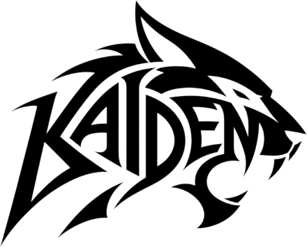
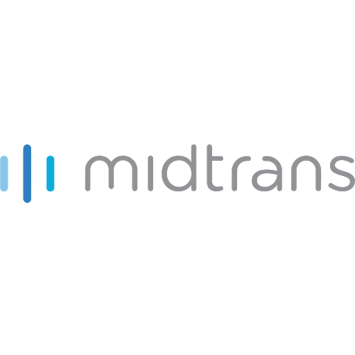
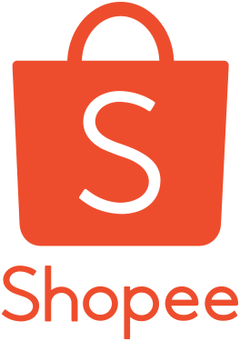
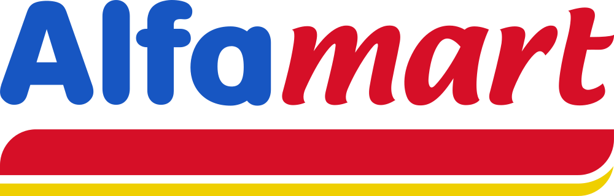

<p align="center">
  <a href="#">
    
  </a>
</p>

<h1 align="center">KAIDEN — Sistem Top Up Game Online & Produk Digital</h1>

<p align="center">
  Platform top-up game online dan produk digital berbasis <strong>Laravel 12</strong>, <strong>Tailwind CSS</strong>, dan <strong>Vite</strong> dengan arsitektur <em>Enterprise-Grade</em>. Dilengkapi sistem <strong>Role-Based Access Control (RBAC)</strong> yang ketat, pembayaran otomatis via <strong>Midtrans Snap</strong>, pemenuhan pesanan kilat via <strong>API Digiflazz</strong>, proteksi anti-rugi modal dinamis, serta pelacakan audit trail yang tidak dapat diubah (<em>immutable</em>).
</p>

<p align="center">
  <a href="https://github.com/hidayaturromadhan/kaiden-topup-platform/actions"></a>
  
  
  
  
  
  
</p>

---

## 📑 Daftar Isi

- [Fitur Utama](#-fitur-utama)
- [Tampilan & Metode Pembayaran](#-tampilan--metode-pembayaran)
- [Game yang Didukung](#-game-yang-didukung)
- [Arsitektur & Keamanan](#-arsitektur--keamanan)
- [Panduan Instalasi Lokal](#-panduan-instalasi-lokal)
- [Konfigurasi Environment (.env)](#-konfigurasi-environment-env)
- [Pengujian Otomatis (Automated Tests)](#-pengujian-otomatis-automated-tests)
- [Struktur Database](#-struktur-database)
- [Kebijakan Keamanan (Security Policy)](#-kebijakan-keamanan-security-policy)
- [Lisensi](#-lisensi)

---

## 🚀 Fitur Utama

### 1. 🛡️ Role-Based Access Control (RBAC) & Anti-IDOR
- **Superadmin:** Akses penuh konfigurasi sistem, audit log finansial, manajemen role & permission, dan manajemen pengguna internal.
- **Admin:** Mengelola katalog game, produk, promosi banner, pemantauan saldo deposit Digiflazz, dan rekapitulasi transaksi pesanan.
- **Pelanggan:** Akses pembuatan pesanan, riwayat belanja mandiri, verifikasi ID game, dan ulasan pesanan.
- **Anti-IDOR:** Pelanggan dilarang keras melihat pesanan pelanggan lain; staf internal dilarang membuat pesanan langsung untuk menjaga pemisahan tugas (*separation of duties*).

### 2. 💳 Integrasi Multi-Channel Payment Gateway (Midtrans Snap)
- Mendukung pembayaran real-time menggunakan **QRIS**, **Virtual Account** (BCA, Mandiri, BNI, BRI, Permata, CIMB), **E-Wallet** (GoPay, DANA, OVO, ShopeePay), dan **Gerai Ritel** (Indomaret, Alfamart).
- Verifikasi signature SHA-512 dua arah dan penanganan webhook yang idempoten untuk mencegah manipulasi pembayaran atau notifikasi ganda.

### 3. ⚡ Pemenuhan Pesanan Otomatis (Digiflazz Live API)
- Penarikan katalog harga prabayar (*price-list*) resmi Digiflazz dengan penanganan limitasi *cooldown* server (*Response Code 83*).
- **Proteksi Anti-Rugi Otomatis:** Sistem secara proaktif menaikkan harga jual apabila harga modal supplier mengalami kenaikan, memastikan bisnis tidak pernah menjual rugi (*zero loss guarantee*).
- **Validasi Kesiapan Stok Sebelum Pembayaran:** Jika saldo operasional supplier sedang dalam pembaruan atau di bawah harga modal produk, sistem secara elegan menonaktifkan kartu produk dan memberi penanda *"Pembaruan Stok"* tanpa membocorkan istilah teknis modal internal ke pelanggan.

### 4. 🎮 Pengecekan Nickname Game Otomatis (IGN Checker)
- Verifikasi username pemain secara langsung sebelum transaksi (*Mobile Legends, Free Fire, Valorant, dll.*) dengan sistem caching cerdas untuk menghemat kuota pengecekan.
- Opsi konfirmasi manual berstandar fallback jika server pihak ketiga sedang dalam pemeliharaan.

### 5. 🎨 Pengalaman Pengguna (UI/UX) Berkelas
- **Filter & Live Search Tanpa Reload:** Menggunakan navigasi AJAX dinamis berkecepatan tinggi dengan efek **Skeleton Loading Web Render**.
- **Jam Realtime WIB:** Indikator waktu server Indonesia Barat (WIB) dengan animasi detak aktif (*pulsing status*).
- **Dark Mode & Light Mode:** Dukungan tema gelap/terang dinamis dengan deteksi preferensi sistem dan penyimpanan status lokal.
- **Testimoni Pelanggan & Privasi Nickname:** Pop-up ulasan pesanan secara live di beranda dengan sensor privasi nickname otomatis (contoh: `gamerabah` $\rightarrow$ `ga******bah`).
- **Sistem Notifikasi Modern:** Integrasi Notiflix & Notyf terpadu untuk alert validasi dan konfirmasi transaksi.

---

## 💳 Tampilan & Metode Pembayaran

Didukung oleh gerbang pembayaran terpercaya untuk kenyamanan seluruh pelanggan:

<p align="center">
  &nbsp;&nbsp;&nbsp;&nbsp;
  &nbsp;&nbsp;&nbsp;&nbsp;
  &nbsp;&nbsp;&nbsp;&nbsp;
  &nbsp;&nbsp;&nbsp;&nbsp;
  &nbsp;&nbsp;&nbsp;&nbsp;
  &nbsp;&nbsp;&nbsp;&nbsp;
  &nbsp;&nbsp;&nbsp;&nbsp;
  &nbsp;&nbsp;&nbsp;&nbsp;
  &nbsp;&nbsp;&nbsp;&nbsp;
  &nbsp;&nbsp;&nbsp;&nbsp;
  
</p>

---

## 🕹️ Game yang Didukung

Katalog top-up langsung terhubung dengan denominasi supplier resmi:

| Game | Publisher | Kategori | Kode Checker |
| :--- | :--- | :--- | :--- |
| **Mobile Legends: Bang Bang** | Moonton | MOBA | `MOBILE_LEGENDS` |
| **Free Fire** | Garena | Battle Royale | `FREEFIRE` |
| **Valorant** | Riot Games | FPS | `VALORANT` |
| **Call of Duty: Mobile** | Garena / Activision | FPS | `CALL_OF_DUTY` |
| **Arena of Valor (AOV)** | Garena | MOBA | `AOV` |

---

## 🔒 Arsitektur & Keamanan

Sistem dirancang dengan prinsip **Defense-in-Depth**:
- **Audit Logging Immutability:** Seluruh aktivitas perubahan harga produk, mutasi status pesanan, penyesuaian stok, serta integrasi supplier tercatat di tabel `audit_logs` dan bersifat *append-only*.
- **Enkripsi Kunci API:** Kredensial sensitif dienkripsi pada layer penyimpanan menggunakan algoritma AES-256 bawaan Laravel.
- **Rate Limiting:** Rute publik pengecekan nickname dan submit pesanan diproteksi dengan *rate limiter* berbasis IP dan session untuk mencegah serangan DoS / Brute-Force.
- **Strict CSRF & Input Sanitization:** Form checkout diamankan dengan token CSRF dan validasi tipe data berlapis.

---

## 💻 Panduan Instalasi Lokal

### 1. Kebutuhan Sistem
- **PHP:** $\ge$ 8.2 (ekstensi: `pdo_mysql`, `curl`, `mbstring`, `openssl`, `bcmath`)
- **Composer:** $\ge$ 2.x
- **Node.js:** $\ge$ 18.x & **NPM**
- **Database:** MySQL $\ge$ 8.0 atau MariaDB $\ge$ 10.4

### 2. Kloning Repository
```bash
git clone https://github.com/hidayaturromadhan/kaiden-topup-platform.git
cd kaiden-topup-platform
```

### 3. Instal Dependensi Backend & Frontend
```bash
composer install
npm install
```

### 4. Konfigurasi Environment
Salin file `.env.example` menjadi `.env`:
```bash
cp .env.example .env
```
Buat kunci aplikasi (*App Key*):
```bash
php artisan key:generate
```

### 5. Migrasi & Seeding Database
Jalankan migrasi tabel beserta akun awal (Superadmin, Admin, Pelanggan, Role RBAC, Game & Produk Awal):
```bash
php artisan migrate --seed
```

> [!NOTE]
> Akun default yang dibuat oleh seeder:
> - **Superadmin:** `superadmin@kaiden.id` / `Password123!`
> - **Admin:** `admin@kaiden.id` / `Password123!`
> - **Pelanggan:** `pelanggan@kaiden.id` / `Password123!`

### 6. Kompilasi Aset Frontend & Jalankan Server
Buka dua terminal terpisah:
```bash
# Terminal 1: Vite Hot Reload
npm run dev

# Terminal 2: Laravel Development Server
php artisan serve
```
Buka browser Anda dan akses aplikasi di: **`http://127.0.0.1:8000`**

---

## ⚙️ Konfigurasi Environment (.env)

Pastikan untuk mengisi variabel integrasi pembayaran dan supplier pada file `.env` lokal Anda:

```env
APP_NAME=KAIDEN
APP_ENV=local
APP_DEBUG=true
APP_URL=http://localhost:8000
APP_TIMEZONE=Asia/Jakarta

DB_CONNECTION=mysql
DB_HOST=127.0.0.1
DB_PORT=3306
DB_DATABASE=kaiden
DB_USERNAME=root
DB_PASSWORD=

# Integrasi Midtrans Snap Payment Gateway
MIDTRANS_SERVER_KEY=your-midtrans-server-key
MIDTRANS_CLIENT_KEY=your-midtrans-client-key
MIDTRANS_IS_PRODUCTION=false
MIDTRANS_SNAP_URL=https://app.sandbox.midtrans.com/snap/snap.js

# Integrasi Supplier Top Up (Digiflazz Live API)
DIGIFLAZZ_USERNAME=your-digiflazz-username
DIGIFLAZZ_API_KEY=your-digiflazz-api-key
DIGIFLAZZ_BASE_URL=https://api.digiflazz.com/v1

# Fitur Pengecekan Username / ID Game
IGN_CHECKER_ENABLED=true
```

> [!CAUTION]
> **Pemberitahuan Keamanan Penting:** Jangan pernah mengunggah atau membagikan file `.env` asli yang berisi kunci API produksi Anda ke repository GitHub publik. Selalu gunakan file `.env.example` untuk referensi publik.

---

## 🧪 Pengujian Otomatis (Automated Tests)

Aplikasi memiliki rangkaian automated unit dan feature tests yang komprehensif untuk memastikan seluruh alur bisnis berjalan stabil:

```bash
php artisan test
```

### Cakupan Pengujian (39 Tests Passed / 158 Assertions):
- `Tests\Feature\RbacSecurityTest`: Otorisasi hak akses tiap role, pencegahan eskalasi role, pemisahan tugas, dan immutability audit log.
- `Tests\Feature\ProductPricingTest`: Proteksi margin keuntungan anti-rugi, transparansi diskon promo, dan kenaikan otomatis harga jual jika supplier menaikkan modal.
- `Tests\Feature\IntegrationFlowTest`: Webhook Midtrans idempotency, pengecekan IGN, monitoring ambang batas saldo Digiflazz, dan webhook fulfillment.
- `Tests\Feature\CatalogTest`: Rendering katalog produk, filtering asynchronous, serta pemesanan via parameter query.
- `Tests\Feature\BannerAdminTest`: Manajemen banner promosi beranda.
- `Tests\Feature\ReviewFeedbackTest`: Ulasan pelanggan paska transaksi dan algoritma sensor nickname pada pop-up testimoni.

---

## 🗄️ Struktur Database

Hubungan data utama dalam platform KAIDEN:

```
[Users] ──< [RoleUser] >── [Roles] ──< [PermissionRole] >── [Permissions]
   │
   ├──< [Orders]
           │
           ├─── [Products] ───< [Games]
           ├─── [Payments]
           ├─── [Fulfillments]
           └─── [Reviews]

[AuditLogs] (Append-Only Log Trail)
[Banners] (Promosi Beranda)
[Settings] (Konfigurasi Dinamis Terenkripsi)
```

---

## 🛡️ Kebijakan Keamanan (Security Policy)

Jika Anda menemukan celah keamanan (*vulnerability*) pada platform ini, mohon untuk tidak membuat *public issue*. Silakan hubungi tim pengembang secara privat melalui kontak resmi yang tertera.

---

## 📄 Lisensi

Proyek ini dilisensikan di bawah [MIT License](LICENSE). Anda bebas menggunakannya untuk pembelajaran maupun pengembangan lebih lanjut.

<p align="center">
  Dibuat dengan dedikasi untuk performa dan keamanan oleh <strong>Hidayatur Romadhan</strong> & <strong>KAIDEN Development Team</strong>.
</p>
