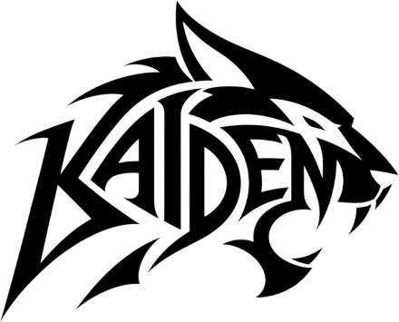
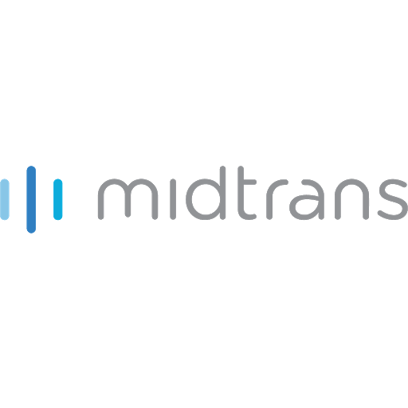
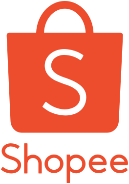
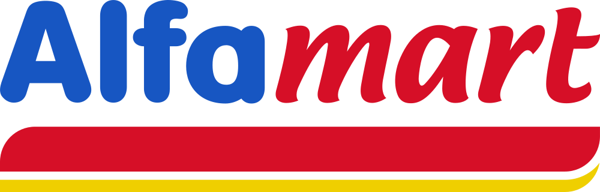

<p align="center">
  <a href="#">
    
  </a>
</p>

<h1 align="center">KAIDEN — Sistem Top Up Game Online & Produk Digital</h1>

<p align="center">
  Platform top-up game online dan produk digital berbasis <strong>Laravel 12</strong>, <strong>Tailwind CSS</strong>, dan <strong>Vite</strong> dengan arsitektur <em>Enterprise-Grade</em>. Dilengkapi sistem <strong>Role-Based Access Control (RBAC)</strong> yang ketat, pembayaran otomatis via <strong>Midtrans Snap</strong>, pemenuhan pesanan kilat via <strong>API Digiflazz</strong>, proteksi anti-rugi modal dinamis, retry pemenuhan manual cerdas, serta pelacakan audit trail yang tidak dapat diubah (<em>immutable</em>).
</p>

<p align="center">
  <a href="https://github.com/hidayaturromadhan/kaiden-topup-platform/actions"></a>
  
  
  
  
  
  
  
</p>

---

## 📑 Daftar Isi

- [Fitur Utama](#-fitur-utama)
- [Tampilan & Metode Pembayaran](#-tampilan--metode-pembayaran)
- [Game yang Didukung](#-game-yang-didukung)
- [Arsitektur & Keamanan](#-arsitektur--keamanan)
- [Panduan Instalasi Lokal](#-panduan-instalasi-lokal)
- [Konfigurasi Environment (.env)](#-konfigurasi-environment-env)
- [Pengujian Otomatis & Validitas Akademik](#-pengujian-otomatis--validitas-akademik)
- [Struktur Database](#-struktur-database)
- [Kebijakan Keamanan (Security Policy)](#-kebijakan-keamanan-security-policy)
- [Lisensi](#-lisensi)

---

## 🚀 Fitur Utama

### 1. 🛡️ Role-Based Access Control (RBAC) & Anti-IDOR
- **Superadmin:** Hak akses penuh konfigurasi sistem, audit log finansial & mutasi data, manajemen role & matriks perizinan, pengaturan kunci API terenkripsi, serta tata kelola akun pengguna staf.
- **Admin Operasional:** Mengelola katalog game, produk denominasi, promosi banner, feedback/ulasan pelanggan, pemantauan saldo deposit Digiflazz, pemrosesan ulang pesanan (*retry*), dan rekapitulasi laporan finansial/ekspor CSV.
- **Pelanggan:** Akses pembuatan pesanan instan, riwayat transaksi mandiri, verifikasi ID/nickname game, pelacakan invoice publik, serta pemberian rating & ulasan paska-pembelian.
- **Pencegahan OWASP Top 10:** 
  - **Anti-IDOR:** Pelanggan dilarang keras mengakses invoice atau data belanja pelanggan lain (HTTP 403).
  - **Pemisahan Tugas (*Separation of Duties*):** Staf admin dilarang membuat pesanan langsung dari rute checkout untuk menjaga akuntabilitas audit finansial.
  - **Forced Browsing & Escalation Guard:** Proteksi middleware berlapis terhadap manipulasi peran (*mass-assignment protection*) dan pembatasan rute internal.

### 2. 💳 Integrasi Multi-Channel Payment Gateway (Midtrans Snap)
- Mendukung pembayaran *real-time* via **QRIS**, **Virtual Account** (BCA, Mandiri, BNI, BRI, Permata, CIMB Niaga), **E-Wallet** (GoPay, DANA, OVO, ShopeePay), dan **Gerai Retail** (Indomaret, Alfamart).
- Verifikasi signature kriptografi SHA-512 dua arah dan penanganan webhook yang **idempoten** untuk mencegah manipulasi nominal pembayaran atau pemrosesan pesanan ganda.

### 3. ⚡ Pemenuhan Pesanan Otomatis & Retry Cerdas (Digiflazz Live API)
- Penarikan katalog harga prabayar (*price-list*) resmi Digiflazz dengan penanganan limitasi *cooldown* server (*Response Code 83*).
- **Proteksi Anti-Rugi Otomatis:** Sistem secara dinamis menaikkan harga jual apabila harga modal supplier mengalami kenaikan, memastikan margin laba usaha selalu terjaga (*zero-loss guarantee*).
- **Validasi Kesiapan Modal Sebelum Checkout:** Jika saldo deposit supplier di bawah harga modal produk, sistem secara otomatis menonaktifkan produk dan menampilkan penanda *"Pembaruan Stok"* tanpa membocorkan istilah teknis operasional ke pembeli.
- **Mekanisme Proses Ulang Manual (*Manual Retry Fulfillment*):**
  - Jika pesanan sempat gagal akibat kendala supplier (*Cut Off* perbaikan sistem seller), Admin dapat memicu pemrosesan ulang secara instan via tombol manual beranimasi di panel admin setelah supplier normal kembali.
  - Dilengkapi dialog konfirmasi bermodal elegan (Notiflix UI) dan pencatatan otomatis ke dalam audit trail.

### 4. 🎮 Pengecekan Nickname Game Otomatis (IGN Checker)
- Verifikasi username pemain secara langsung sebelum transaksi (*Mobile Legends, Free Fire, Valorant, Blood Strike, dll.*) dengan sistem *caching* cerdas dan rate limiting (8 req/menit) untuk mencegah eksploitasi API.
- **Graceful Fallback:** Jika server game pihak ketiga mengalami pemeliharaan atau timeout, sistem tetap memberikan opsi konfirmasi mandiri tanpa memblokir alur checkout pelanggan.

### 5. 🎨 Pengalaman Pengguna (UI/UX) Berkelas
- **Carousel Game Responsif (1 Baris Geser):** Tampilan daftar game modern dengan mekanisme geser halus (*ease-out cubic physics scroll*), navigasi tombol terintegrasi di header, dan dukungan *mouse drag-to-scroll*.
- **Filter & Live Search Tanpa Reload:** Navigasi kategori dinamis berkecepatan tinggi dengan efek *Skeleton Loading Web Render*.
- **Jam Realtime WIB:** Indikator waktu server Indonesia Barat (WIB) dengan animasi detak aktif (*pulsing status*).
- **Dark Mode & Light Mode:** Dukungan tema gelap/terang dinamis dengan deteksi preferensi sistem dan persistensi lokal.
- **Testimoni Pelanggan & Privasi Nickname:** Pop-up ulasan pesanan secara *live* di beranda dengan algoritma sensor privasi nickname otomatis (contoh: `gamerabah` $\rightarrow$ `ga******bah`).
- **Sistem Notifikasi Modern:** Integrasi Notiflix & Notyf terpadu untuk alert validasi dan konfirmasi transaksi interaktif.

---

## 💳 Tampilan & Metode Pembayaran

Didukung oleh gerbang pembayaran terpercaya untuk kenyamanan seluruh pelanggan:

<p align="center">
  &nbsp;&nbsp;&nbsp;&nbsp;
  &nbsp;&nbsp;&nbsp;&nbsp;
  &nbsp;&nbsp;&nbsp;&nbsp;
  &nbsp;&nbsp;&nbsp;&nbsp;
  &nbsp;&nbsp;&nbsp;&nbsp;
  &nbsp;&nbsp;&nbsp;&nbsp;
  &nbsp;&nbsp;&nbsp;&nbsp;
  &nbsp;&nbsp;&nbsp;&nbsp;
  &nbsp;&nbsp;&nbsp;&nbsp;
  &nbsp;&nbsp;&nbsp;&nbsp;
  
</p>

---

## 🕹️ Game yang Didukung

Katalog top-up langsung terhubung dengan denominasi supplier resmi:

| Game | Publisher | Kategori | Fitur Pengecekan ID |
| :--- | :--- | :--- | :--- |
| **Mobile Legends: Bang Bang** | Moonton | MOBA | User ID + Zone ID |
| **Free Fire & Free Fire Max** | Garena | Battle Royale | User ID |
| **Blood Strike** | NetEase | FPS | User ID |
| **Valorant** | Riot Games | FPS | Riot ID + Tagline |
| **Call of Duty: Mobile** | Garena / Activision | FPS | OpenID |
| **PUBG Mobile** | Tencent Games | Battle Royale | Player ID |
| **Arena of Valor (AOV)** | Garena | MOBA | OpenID |
| **Magic Chess: Go Go** | Moonton | Auto Battler | User ID + Server ID |
| **Growtopia** | Ubisoft | Online Sandbox | GrowID |

---

## 🔒 Arsitektur & Keamanan

Sistem dirancang dengan prinsip **Defense-in-Depth**:
- **Audit Logging Immutability (Append-Only):** Seluruh aktivitas perubahan harga produk, mutasi status pesanan, penyesuaian ketersediaan, pembaruan kunci API, serta aksi *retry* pemenuhan dicatat di tabel `audit_logs`. Model `AuditLog` menolak mutlak operasi `update` dan `delete` via `RuntimeException`.
- **Enkripsi Kunci API:** Kredensial sensitif dienkripsi pada layer penyimpanan menggunakan algoritma AES-256 bawaan Laravel dan disamarkan (*masked*) pada tampilan antarmuka.
- **Rate Limiting:** Rute publik pengecekan nickname dan checkout pesanan diproteksi dengan *rate limiter* berbasis IP dan session untuk mencegah serangan DoS atau eksploitasi pihak ketiga.
- **Idempotensi Transaksi:** Menjamin satu kode transaksi unik hanya diproses tepat satu kali baik pada gateway pembayaran Midtrans maupun pemenuhan Digiflazz (`ref_id`).

---

## 💻 Panduan Instalasi Lokal

### 1. Kebutuhan Sistem
- **PHP:** $\ge$ 8.2 (ekstensi: `pdo_mysql`, `curl`, `mbstring`, `openssl`, `bcmath`, `fileinfo`)
- **Composer:** $\ge$ 2.x
- **Node.js:** $\ge$ 18.x & **NPM**
- **Database:** MariaDB $\ge$ 10.4 atau MySQL $\ge$ 8.0

### 2. Kloning Repository
```bash
git clone https://github.com/hidayaturromadhan/kaiden-topup-platform.git
cd kaiden-topup-platform
```

### 3. Instal Dependensi Backend & Frontend
```bash
composer install
npm install
```

### 4. Konfigurasi Environment
Salin file `.env.example` menjadi `.env`:
```bash
cp .env.example .env
```
Buat kunci aplikasi (*App Key*):
```bash
php artisan key:generate
```

### 5. Migrasi & Seeding Database
Jalankan migrasi tabel beserta akun awal (Superadmin, Admin, Pelanggan, Matriks RBAC, Banner, Game & Denominasi Produk):
```bash
php artisan migrate --seed
```

> [!NOTE]
> Akun default yang dibuat oleh seeder:
> - **Superadmin:** `superadmin@kaiden.id` / `Password123!`
> - **Admin:** `admin@kaiden.id` / `Password123!`
> - **Pelanggan:** `pelanggan@kaiden.id` / `Password123!`

### 6. Kompilasi Aset Frontend & Jalankan Server
```bash
# Terminal 1: Kompilasi Frontend
npm run build # atau npm run dev untuk hot-reload

# Terminal 2: Laravel Development Server
php artisan serve
```
Akses aplikasi melalui peramban di: **`http://127.0.0.1:8000`**

---

## ⚙️ Konfigurasi Environment (.env)

Pastikan untuk mengisi variabel integrasi pembayaran dan supplier pada file `.env` lokal Anda:

```env
APP_NAME=KAIDEN
APP_ENV=local
APP_DEBUG=true
APP_URL=http://localhost:8000
APP_TIMEZONE=Asia/Jakarta

DB_CONNECTION=mysql
DB_HOST=127.0.0.1
DB_PORT=3306
DB_DATABASE=kaiden
DB_USERNAME=root
DB_PASSWORD=

# Integrasi Midtrans Snap Payment Gateway
MIDTRANS_SERVER_KEY=your-midtrans-server-key
MIDTRANS_CLIENT_KEY=your-midtrans-client-key
MIDTRANS_IS_PRODUCTION=false
MIDTRANS_SNAP_URL=https://app.sandbox.midtrans.com/snap/snap.js

# Integrasi Supplier Top Up (Digiflazz Live API)
DIGIFLAZZ_USERNAME=your-digiflazz-username
DIGIFLAZZ_API_KEY=your-digiflazz-api-key
DIGIFLAZZ_BASE_URL=https://api.digiflazz.com/v1

# Fitur Pengecekan Username / ID Game (IGN Checker)
IGN_CHECKER_ENABLED=true
```

> [!CAUTION]
> **Pemberitahuan Keamanan Penting:** Jangan pernah mengunggah atau membagikan file `.env` asli yang berisi kunci API produksi ke repositori publik.

---

## 🧪 Pengujian Otomatis & Validitas Akademik

Aplikasi telah divalidasi menggunakan rangkaian pengujian otomatis (*Automated Test Suite*) berbasis PHPUnit yang memenuhi seluruh parameter pengujian Bab IV Skripsi:

```bash
php artisan test
```

### Rekapitulasi Hasil Pengujian (100% Pass Rate):
- **Total Test Cases:** **57 Tests Passed**
- **Total Assertions:** **325 Assertions Valid**
- **Tingkat Kelulusan:** **100% (0 Error, 0 Gagal, 0 Diabaikan)**

### Matriks Pengujian Sesuai Standar Skripsi:
1. **Tabel 4.2 Matriks Hak Akses RBAC (`RbacMatrixTableTest` & `RbacSecurityTest`):** 45 kombinasi izin peran (Pelanggan vs Admin Operasional vs Superadmin) terbukti 100% valid dan mematuhi batas otoritas.
2. **Tabel 4.3 Pengujian Keamanan OWASP Top 10 (`UnauthorizedAccessTableTest`):** Verifikasi blokir celah IDOR (HTTP 403), Forced Browsing, Privilege Escalation, Mass Assignment, dan Parameter Tampering.
3. **Tabel 4.4 Integrasi Midtrans (`MidtransIntegrationTableTest`):** Simulasi webhook Settlement, Pending, Cancel, Expire, penolakan Signature Key palsu, dan idempotensi notifikasi ganda.
4. **Tabel 4.5 Integrasi Digiflazz (`DigiflazzIntegrationTableTest` & `OrderRetryTest`):** Pemenuhan otomatis sukses, penanganan timeout/pending, pencatatan alasan kegagalan seller/cut-off, proteksi ref_id, peringatan saldo kritis, serta pengujian mekanisme tombol retry manual.
5. **Tabel 4.6 Pengecekan Nickname Game (`IgnCheckerIntegrationTableTest`):** Verifikasi ID akun valid, penanganan ID salah, graceful fallback saat timeout/offline, rate limiting (HTTP 429), dan toggle feature flag.
6. **Tabel 4.7 Integritas Audit Log (`AuditLogVerificationTableTest`):** Perekaman mutasi harga, stok, peran, penyamaran (*masking*) API key, login staf, ekspor laporan, serta penegakan sifat *append-only*.

> [!TIP]
> Dokumen laporan pengujian berformat akademik resmi untuk Dosen Pembimbing dapat dilihat pada berkas **`LAPORAN_PENGUJIAN_SISTEM_KAIDEN.pdf`**.

---

## 🗄️ Struktur Database

Hubungan data utama dalam platform KAIDEN:

```
[Users] ──< [RoleUser] >── [Roles] ──< [PermissionRole] >── [Permissions]
   │
   ├──< [Orders]
           │
           ├─── [Products] ───< [Games]
           ├─── [Payments]
           ├─── [Fulfillments]
           └─── [Reviews]

[AuditLogs] (Append-Only Log Trail)
[Banners] (Promosi Beranda Dinamis)
[Settings] (Konfigurasi Dinamis Terenkripsi)
```

---

## 🛡️ Kebijakan Keamanan (Security Policy)

Jika Anda menemukan celah keamanan (*vulnerability*) pada platform ini, mohon untuk tidak membuat *public issue*. Silakan hubungi pengembang secara privat melalui kontak resmi yang tertera.

---

## 📄 Lisensi

Proyek ini dilisensikan di bawah [MIT License](LICENSE).

<p align="center">
  Dibuat dengan dedikasi untuk performa dan keamanan oleh <strong>Hidayatur Romadhan</strong> & <strong>KAIDEN Development Team</strong>.
</p>
